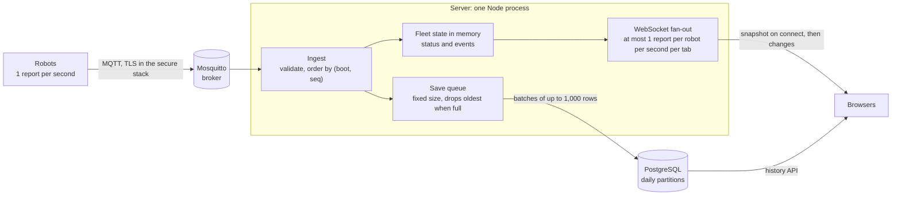

# Fleet Monitor

A live dashboard for a fleet manager who watches warehouse robots.
The manager has one question: **"Which robots need my attention right now?"**
They should get the answer in under 3 seconds.

The rule behind every choice: **calm when all is fine, loud only when something is wrong.**

This file is the only document. It holds how to run the project, the reason for each decision, what is not done, and how the system would grow.

## In short

- **What it is.** A React dashboard on a real ingest path: robots → MQTT (Mosquitto) → one Node server → WebSocket to the browser, with PostgreSQL for history. A demo backend with scripted incidents runs in one container, so the interface can be reviewed without the full stack.
- **Review it in 10 minutes:**
  1. Run `docker compose --profile demo up --build demo` and open http://localhost:8788. The incidents are already on screen.
  2. Read [Part 2](#part-2--all-decisions-in-one-place): each decision, what I rejected, and what would make me change it.
  3. Look at the core code: [fleet.ts](backend/src/server/domain/fleet.ts) (status, ordering, freshness), [batchWriter.ts](backend/src/server/persist/batchWriter.ts) (the bounded save queue), [status.ts](shared/src/status.ts) (the one status model used by server and browser), [store.ts](frontend/src/data/store.ts) (the browser state).
- **Where it stands.** 1,000 robots use 15 % of one core. At that size a report reaches the browser in about 20 ms at p99. One server handled 10,000 messages a second with headroom, and 20,000 a second with no data lost ([load results](#measured-load)). A broker or database outage never marks robots offline and never stops the live view.
- **What I cut first** ([Part 3](#part-3--what-is-not-done-yet)): user sign-in, a second server for failover, and browser tests against the real stack. The time went into status that stays correct when parts fail, because a false "offline" is the most expensive mistake for this user.

## Contents

- [How it works](#how-it-works)
- [Part 1 — Running it](#part-1--running-it)
- [Part 2 — All decisions in one place](#part-2--all-decisions-in-one-place)
- [Part 3 — What is not done yet](#part-3--what-is-not-done-yet)
- [Part 4 — If traffic grows 10× to 1000×](#part-4--if-traffic-grows-10-to-1000)
- [Repository structure](#repository-structure)

---

# How it works



Each report takes two paths. The **live path** updates the fleet state in memory and sends the change to every open browser. It never waits for the database. The **save path** puts the row in a queue of fixed size that writes to PostgreSQL in batches. If the database is slow or down, the queue fills and the oldest rows are dropped. The live view is not affected.

The server also watches its own inputs. If the broker link drops, or stays open with no data for 5 s, the server **freezes** freshness: no robot turns offline because of a problem on our side, and the browser shows "Robot data paused". The browser does the same for its own WebSocket.

## Targets

The 3 seconds is the manager's reading time. The system's part is to keep what they read fresh and correct:

| Target | Value | Source |
|---|---|---|
| A report appears on screen | p99 under 1 s | About 20 ms at 1,000 robots (p99 robot → server 19 ms, server → browser 1 ms). Server → browser stays under 1 s at every [load step](#measured-load). |
| A silent robot shows "Offline" | 10 s after its last report, plus up to 1 s | `OFFLINE_AFTER_MS` in [status.ts](shared/src/status.ts), checked every second |
| Our own link breaks → "Robot data paused" | At once on disconnect; within 5 s if the link is open but silent | `STALL_MS` in [fleet.ts](backend/src/server/domain/fleet.ts) |
| False "offline" caused by our own outage | Never | D8, covered by unit, integration and end-to-end tests |

## Terms used below

- **Report**: the message the server sends to the browser for one robot: battery, position, state, task, and the time the server received it.
- **Freshness**: how long since the server last heard from a robot, always measured with server time, never robot time.
- **Freeze**: while our own link is down, the freshness clock stops, so silence caused by us is not read as robots going offline.
- **Settle window**: after our link comes back, we wait 3 s before judging freshness again, so the reports held up during the gap arrive first.
- **Stalled link**: the broker connection is open, but no robot message has arrived for 5 s. It is treated like a broken link.
- **Low-battery latch**: a robot turns low below 20 % and turns OK again only at 22 %, so it does not flicker around 20 %.
- **`never`**: a robot that is registered but has not reported yet.

---

# Part 1 — Running it

## Requirements

- **Docker** runs everything. Node is not needed.
- To run tests or work on the code: **Node 24** (see `.nvmrc`) and Docker.

## A. The demo

The demo is one container. Its backend is a simulator, and the scripted incidents are already on screen when the page opens.

```bash
docker compose --profile demo up --build demo
```

Open **http://localhost:8788**.

## B. Screens and states

| State | Where |
|---|---|
| Overview, dark | `/`, with your system in dark mode, or click the moon in the top bar |
| Overview, light | `/`, click the sun. The choice is remembered. |
| Offline filter | `/?status=offline` |
| Connection lost | The outage command below |
| Robot with low battery | `/robots/R-017` |
| Robot that is offline | `/robots/R-041` |
| Robot that never reported | `/robots/R-051` |
| Site with no robots | `/?site=be` |
| Search with no results | `/?site=hh&status=error&q=R-09` |
| Floor plan | `/floor-plan?site=le&robot=R-024` |
| Component sheet | `/dev/components` (built from the real components) |
| 1024 px laptop | A narrow window. Two columns hide and the site moves under the robot ID. |

To cut the connection for 20 seconds:

```bash
curl -X POST 'http://localhost:8788/control/outage?seconds=20'
```

While it is cut, **no robot turns offline** because of it. The banner shows, values turn grey, and "last seen" keeps counting.

The scripted incidents:

| Robot | What happens | What it shows |
|---|---|---|
| R-009 | Offline for 34 s | Offline, short |
| R-041 | Offline for 3 min, after a weak Wi-Fi warning | Offline, long. The event log says why. |
| R-017 | 14 % battery, on its way to charge | Low battery on the detail page |
| R-032 | 9 % battery, all docks busy. A dock frees up after 10 min. | Low battery, then recovery |
| R-024 | Error: "Motor overcurrent" | Error |
| R-028 | Drops below 20 % about 7 s after start | The row highlight on a status change |
| R-051 | Registered, never reported | The `never` state |

Restart the container to replay them. After about 10 minutes the low robots charge and recover, like a real fleet.

## C. The production stack

This is the production design from [How it works](#how-it-works): robots talk MQTT to a broker, a server saves data to PostgreSQL, and the browser gets live data from the server.

```bash
docker compose up --build        # http://localhost:8787
```

Here the incidents happen **live** in the first minute:

- **+8 s:** R-024 reports a fault.
- **+20 s:** R-041 warns about weak Wi-Fi.
- **+35 s:** R-009 goes silent but stays connected.
- **+45 s:** R-041 drops its link, so the broker announces it is gone.

A broker outage:

```bash
docker compose stop mosquitto    # the dashboard says "Robot data paused". No robot turns offline.
docker compose start mosquitto   # it recovers by itself
docker compose down -v           # stop everything and delete the database
```

If a port is busy, move it: `APP_PORT=9787 PG_PORT=15432 MQTT_PORT=11883 docker compose up --build` (or `DEMO_PORT=…` for the demo).

Set `ROBOTS=1000` to simulate a bigger fleet.

## D. The secure stack

This adds MQTT over TLS with one certificate per robot, HTTPS, and a token on `/metrics`.

```bash
docker compose -f docker-compose.yml -f docker-compose.secure.yml up --build
# app: https://localhost:8443
# The certificates come from a development CA. Accept the browser warning, or trust the CA:
docker compose -f docker-compose.yml -f docker-compose.secure.yml cp server:/certs/ca.crt ./fleet-dev-ca.crt
```

In production, set `TLS_CERT_FILE` / `TLS_KEY_FILE` and `METRICS_TOKEN`. For the broker, set `MQTT_URL=mqtts://…` with `MQTT_CA_FILE`, `MQTT_CERT_FILE` and `MQTT_KEY_FILE`.

## E. Checks and tests

CI runs the same commands on every push and pull request ([.github/workflows/ci.yml](.github/workflows/ci.yml)).

```bash
npm install
npm run lint:install             # once: ESLint has its own install
npx playwright install chromium  # once, before the first e2e run

npm run typecheck                # TypeScript, strict. The only type check: Vitest does not check types.
npm run lint                     # ESLint, zero warnings allowed
npm test                         # unit and component tests, no Docker needed
npm run test:int -w backend      # integration tests against real Postgres + Mosquitto (needs Docker)
npm run test:coverage            # all tests, fails below 95 % coverage (needs Docker)
npm run test:e2e                 # Playwright: the production build in Chromium
```

To run from source instead of Docker:

```bash
npm run dev          # demo: simulator backend on :8787 + app on http://localhost:5173
npm run outage       # drop all browser connections for 20 s

npm run infra        # only Postgres :5432 + Mosquitto :1883 in Docker
npm run seed         # database tables + robot list
npm run dev:prod     # server :8787 + 50 MQTT robots + app on :5173
```

## F. Load tests

```bash
docker compose up -d && docker compose stop robots   # the demo robots add 1.5 s of clock skew to the delay
docker compose --profile load run --rm loadtest --name steps --steps 1000x1,2000x1,5000x1,5000x2,5000x4 --duration 60 --warmup 15
scripts/db-outage.sh   # 5000 robots for 120 s; Postgres is paused for 30 s, 40 s after they connect
```

Each run writes `docs/load/<name>-<timestamp>.json`. The results are in [Part 4](#measured-load).

---

# Part 2 — All decisions in one place

Each decision names what would make me change it.

| # | Decision | Rejected | Change when |
|---|---|---|---|
| D1 | **One status list** (`ok · low · error · offline · never`) in one shared module | Separate connection and battery fields: more exact, but the manager needs one answer per robot | A new independent signal matters, like position accuracy |
| D2 | **WebSocket with a full snapshot on each connect**, no replay | Server-Sent Events (would work; WebSocket leaves room for commands). Replay of missed messages (more state, more edge cases). | The snapshot passes about 10k robots per view → streams filtered per site |
| D3 | **MQTT with Mosquitto** | HTTP POST (no last will, no way back to the robot). EMQX or HiveMQ (for huge clusters). | About 100k robots, or the broker must be clustered |
| D4 | **The live view updates before anything is saved. The save queue has a fixed size and drops its oldest rows when full.** | Blocking the MQTT client (the broker then drops without control). A queue with no limit (memory grows until a crash). | Full history is required, for example for compliance → a durable log (Kafka) between broker and writer |
| D5 | **One server; scale by site** | MQTT shared subscriptions (no per-robot affinity). Redis for current state (an extra service). | The measured limit gets close → one server per site group, or Kafka keyed by robot ID |
| D6 | **Plain PostgreSQL**, daily partitions, `date_bin` | TimescaleDB (not needed at 7 days). InfluxDB (a second database). | More than 30 days, or more than 10k messages/s → TimescaleDB with compression and continuous aggregates |
| D7 | **Order by `(boot, seq)`; freshness by server time** | Robot time (clocks drift) | Robots without sequence numbers |
| D8 | **Freeze freshness when our own link is down**, in browser and server, including a stalled link and the settle window (see [Terms](#terms-used-below)) | Treating all silence as offline | One broker per site → judge fleet-wide silence per site |
| D9 | **Keep the demo backend** next to the real one | Only the real one (the interface would need Docker) | — |
| D10 | **One `shared/` package**, read as TypeScript source | Copying files; publishing a built package | A client in another language → generate from a schema |
| D11 | **Broker rules generated from the registry**, certificate name = robot ID | Passwords per robot; a dynamic auth plugin | Thousands of provisioning changes a day |
| D12 | **A row the database refuses is dropped alone.** Text with a null character is rejected at the edge. Any other bad row is found by splitting the batch in half until only that row fails. | Dropping the whole batch (one bad row loses a second of history for every robot) | Bad rows become common → send them to a dead-letter table instead of the log |

## Where I chose differently from the brief or prototypes

- **The theme follows the system setting** instead of always starting dark (the handoff asks for this; the brief says dark).
- **No fill under the battery line.** The brief says no gradients.
- **A fourth site with no robots,** so the empty state is real.
- **A fifth status, `never`,** for robots that are registered but have not reported yet.
- **Detail pages work for any robot,** not only the two in the prototypes.

## What I disagree with

- **Raw 1 per second history is mostly noise for a manager.** They need status changes and exceptions. So the event log is the main history, and charts are on the detail page.
- **Battery percentage alone is a weak signal.** The real question is "can this robot finish its task?" That needs an energy model and the task plan. I kept one simple threshold and left this as a product question.

## Open questions

1. What fleet size and data retention does a real deployment need?
2. Do robots have a boot counter and a sequence number? If not, ordering falls back to server receive time (D7).
3. Do task events come from the robot or from a separate task system? That decides who publishes to `…/event`.
4. Is 10 s the right offline limit for every site? Sites with weak Wi-Fi may need their own value.
5. Do robots at one site share one uplink? That affects where to place the broker.

---

# Part 3 — What is not done yet

**Running the server**
- **One server only.** If it stops, every dashboard stops.
- **Splitting by site is not finished.** "All sites" cannot show sites that run on other servers.
- **TypeScript runs through `tsx`.** The server is not compiled first.

**Data that can be lost**
- **Events during a server restart are lost.** The broker does not keep them for us.
- **History is lost if the database is down too long.** The save queue holds about 10 s at 5,000 messages a second, then drops the oldest rows. The live view is fine ([measured](#measured-load)).

**Wrong status**
- **A re-flashed robot shows offline for about 10 s.** If its boot counter goes back, the server ignores its reports until it has been silent for the offline limit. Then it accepts the lower counter as a reset and logs it. A boot ID from the firmware (random, not a counter) would remove the gap.
- **A new tab can disagree with the server** for a robot at 20–21 %: the tab starts its low-battery latch from the snapshot, so it shows OK while the server says low. Fixing it means sending the latch in `Report`.
- **Fleet-wide silence shows as "paused",** not "offline".

**Database**
- **Events are kept forever.** Telemetry is deleted after 7 days.
- **Too many state writes.** The last state of each robot is saved every second. Every 10 s would be enough.
- **Reads and writes share one database.** Long history requests can slow down saving. There is no rate limit.
- **"Today" uses the server's time zone,** not the site's.

**Security**
- **No user sign-in.** Anyone who can reach the port sees every site.
- **A stolen robot certificate cannot be blocked** (no CRL or OCSP). The only fix is to remove the robot and rebuild the broker rules.

**Tests**
- **End-to-end tests cover the demo backend only.** The real stack is covered by integration tests, not a browser.
- **No browser profile at 1,000 robots,** and the table is not virtualized. *Change when* a render takes over 16 ms at that size: virtualize the table, and move the attention cards onto `<Ago>`, the small component that redraws only the "12 s ago" text each second.

**Client**
- **One error boundary for the whole view.** If the map crashes, the whole page shows the crash screen.

---

# Part 4 — If traffic grows 10× to 1000×

## Where we are today

| | Today (1×) |
|---|---|
| Robots | 1,000 |
| Messages per second | 1,000 (1 per robot) |
| Server CPU | 15 % of one core |
| Storage | about 14 GB per day (157 bytes per row with indexes) |
| One server, with headroom | 10,000 messages per second |
| One server, no data lost | 20,000 messages per second, with short pauses |

### Measured load

The server, broker, database and load generator all ran on one Docker Desktop VM (8 CPUs, 8 GB), so the numbers are a lower bound for a dedicated server. Each step ran 60 s after a 15 s warm-up.

| Step (robots × Hz) | Accepted/s | Dropped | Server CPU | Ingest lag p99 | Server → browser p99 | Save queue max | Event loop p99, worst 2 s window |
|---|---|---|---|---|---|---|---|
| 1000 × 1 | 1,000 | 0 | 15 % | 19 ms | 1 ms | 481 | 20 ms |
| 2000 × 1 | 1,996 | 0 | 22 % | 325 ms | 755 ms | 813 | 461 ms * |
| 5000 × 1 | 5,004 | 0 | 31 % | 22 ms | 313 ms | 494 | 24 ms |
| 5000 × 2 | 10,000 | 0 | 34 % | 88 ms | 501 ms | 1,169 | 102 ms |
| 5000 × 4 | 19,918 | 0 | 56 % | 156 ms | 248 ms | 17,798 | 559 ms * |

How to read it:

- **The event loop number is the worst 2 s window, not a steady level.** Each value marked * comes from one stall: for one window the accepted rate dips (to 1,865/s and 15,538/s) and the save queue jumps, then both recover. This run did not record the lag per window, so it cannot say whether the cause was garbage collection, the database or the shared host. The load test now records it for every window (`loopP99Ms`).
- **Comfortable limit: 10,000/s.** It is the highest step where the worst window stays at the 100 ms "act now" line below, using a third of one core.
- **No data lost up to 20,000/s, but that is the ceiling, not a planning number.** At that rate one stall filled the save queue to 17,798 of its 50,000 rows. A longer stall would start dropping history.
- **Server → browser p99 is 250–750 ms above 1,000 robots.** Each tab gets at most one report per robot every 900 ms, and the rest wait for the next 250 ms flush.

**Database outage** (5,000/s, Postgres paused for 30 s with `scripts/db-outage.sh`):

- The live view kept accepting 5,000 reports a second the whole time.
- The save queue filled to its cap of 50,000 rows in about 10 s, then dropped the oldest: 101,247 rows, about 20 s of history. This is D4 working as designed.
- After the database came back, the queue drained to near zero within 2 s.

Raw numbers: [steps-2026-11-08.json](docs/load/steps-2026-11-08.json) and [db-outage-2026-11-08.json](docs/load/db-outage-2026-11-08.json).

"Traffic" grows in two directions, and they break different things:

1. **More robots** → more messages in: broker, server, database.
2. **More people watching** → more messages out: the WebSocket fan-out.

## What stays the same at every size

These rules do not depend on size, so they stay:

- The one status model in `shared/` (D1, D10).
- Never mark robots offline because our own path is down (D8). At larger sizes it is judged per site or per region.
- The live view never waits for the database (D4).
- Order by `(boot, seq)` and freshness by server time (D7).
- The interface stays exception-first. At 1 million robots nobody reads every row. The design already shows only the problems, so it scales by design.

## What breaks first at each size

| Size | Robots | Messages/s | What breaks first | Main change |
|---|---|---|---|---|
| 1× | 1,000 | 1,000 | Nothing | — |
| 10× | 10,000 | 10,000 | The browser (every robot goes to every tab), database size and state writes, one server with no backup | Per-view streams, TimescaleDB, a standby server |
| 100× | 100,000 | 100,000 | One broker, one server, the database write rate | Broker and server per site group, Kafka, separate live, write and gateway services, store less raw data |
| 1000× | 1,000,000 | 1,000,000 | One central system at all, and the network to it | Cells and edge servers, robots report on change, storage in tiers |

## How I would change it

**First, measure.** The server already has the metrics that show when a limit is near:

| Signal | Limit that means "act now" |
|---|---|
| Event loop p99 (`nodejs_eventloop_lag_p99_seconds`) | Over 100 ms for minutes |
| `db_batch_write_seconds` p99 | Over 500 ms |
| `ingest_queue_depth` | Does not go back near zero between writes |
| `ingest_dropped_total` | Grows while the database is up |
| Browser render time (React Profiler) | Over 16 ms per update |

**Then change one thing at a time, cheapest first.** Before each step, run the load test at the new target (`--steps 10000x1` and so on), and keep each step easy to undo.

### 10× — 10,000 robots, 10,000 messages per second

*One server still copes:* the 10,000/s step stayed at the event-loop limit using a third of one core ([measured](#measured-load)). The edges break first.

1. **Stop sending every robot to every browser.** Today each tab gets every robot's report, up to one per robot per second: at 10,000 robots that is 10,000 messages a second per tab, and a 2 MB snapshot on connect.
   - The browser sends `subscribe { site, filter }`. The server sends only that site's robots.
   - The "All sites" view gets counts per site plus the robots with problems, not every row. This is what the manager needs anyway.
   - Send one message every 250 ms with all changed reports in it, instead of one message per report.
   - This is the D2 change point: "about 10k robots per view".
2. **Make the browser cheap at size.** Virtualize the table (only draw the rows on screen). Draw map pins on a canvas instead of one SVG element per robot. Profile at 10,000 robots first.
3. **Database.**
   - Save `robot_state` every 10 s, not every 1 s: 1,000 writes a second instead of 10,000. After a restart the state is at most 10 s old, and the next report fixes it.
   - Raw data becomes about 140 GB per day. This is the D6 change point: move to **TimescaleDB** with compression (often about 10× smaller) and continuous aggregates (1-minute buckets), so history reads the small summary, not raw rows.
   - Add a **read replica** for the history API and a rate limit on history requests, so long reads do not slow down writes.
   - Delete events after a set time, like telemetry. Write batches with `COPY` instead of `INSERT`.
4. **No single server.**
   - Run a **standby server**. Only the server that holds a Postgres advisory lock reads from the broker. If it dies, the standby takes the lock, loads `robot_state` and goes on. Browsers reconnect and get a fresh snapshot. (Each server already has its own broker client ID, so two can connect at once.)
   - Compile the server to JavaScript instead of running it through `tsx`.

### 100× — 100,000 robots, 100,000 messages per second

*One server and one broker are no longer enough.* Split the work.

1. **Broker per site group.** Mosquitto runs on one thread and has no clustering. Around 100,000 connections it is near its limit (the D3 change point). Sites are independent, so the simple step is one broker per group of sites. If one site alone is too big, use a clustered broker (EMQX, HiveMQ or VerneMQ).
2. **Server per site group (D5).** The `SITES` setting already exists: each server subscribes only to `fleet/{site}/#` for its sites. A small table in Postgres maps site → server, and each server holds a lease on its sites, so only one server owns a site at a time. Not MQTT shared subscriptions: they break per-robot state.
3. **Put Kafka (or Redpanda) between the brokers and the servers**, keyed by robot ID. This is the D4 change point. It solves three problems at once:
   - Events are no longer lost when a server restarts. Kafka keeps them.
   - When the database is down, the writer catches up from Kafka later, instead of dropping the oldest data.
   - Live state and saving become separate services that scale on their own.
4. **Three kinds of service instead of one server:**
   - **Live service:** reads Kafka, keeps current state in memory, works out status and events. Same domain code as today.
   - **Writer service:** reads Kafka, writes batches to the database.
   - **Gateway service:** holds the browser WebSockets and sends each browser only what it subscribed to. It keeps no robot state, so gateways scale out behind a load balancer. A reconnect gets a fresh snapshot.
   - "All sites" is built from small per-site summaries.
5. **Store less raw data.** At 100,000 per second, raw rows are about 1.4 TB per day. A manager needs events and trends, not every second (see "What I disagree with"). Keep the raw stream in Kafka for 24 hours for debugging; save one sample every 10 s per robot plus every status change (about 10× less); use TimescaleDB multi-node or ClickHouse for telemetry, and keep events and the registry in Postgres.
6. **Binary messages.** Reading JSON is the biggest CPU cost per message. Switch robots and browsers to Protobuf or CBOR, and generate the types from one schema, so `shared/` stays the single source (the D10 change point).

### 1000× — 1,000,000 robots, 1,000,000 messages per second

*No single central system should see every message.*

1. **Cells.** A cell is a full copy of the 100× setup for a set of sites, about 20,000 to 50,000 robots. A site lives in exactly one cell, and a small global directory maps site → cell. A failure hurts one cell, and growth means adding a cell.
2. **Edge servers at big sites.** The broker and a small live service run close to the robots, so the site keeps working if the cloud link drops. The edge sends up only status changes, events and downsampled data, and "our own link is down" is judged per site (the D8 change point).
3. **Robots report on change**, plus a heartbeat every few seconds; offline becomes "no heartbeat for 2 intervals". This needs a firmware change, so it is a product decision as much as a technical one.
4. **A global view from summaries.** Each cell sends counts per status per site plus its problem list every second. The manager drills down region → site → robot, and no browser ever loads a million rows. Older data moves to Parquet files in object storage.
5. **Required, not optional, at this size:** user sign-in with access per site, automatic certificate issuing and revoking (the D11 change point), and more than one region.

### If many more people watch (10× to 1000× more browsers)

This grows apart from the robot count. Today 100 open tabs at 1,000 robots means about 100,000 WebSocket messages a second from one server.

1. **Batch:** one message per site every 250 ms instead of one per report. Each tab then gets about 4 messages a second instead of 1,000.
2. **Encode once:** build each site batch once and send the same bytes to every tab watching that site.
3. **Compress** WebSocket messages (`permessage-deflate`). Robot reports repeat a lot, so they compress well.
4. **Gateways scale out:** they hold no robot state, so add more behind a load balancer. A tab that reconnects to another gateway just gets a fresh snapshot (D2), so no sticky sessions are needed.
5. **Wall screens and shared displays** can use the "All sites" summary stream, which is tiny at any fleet size.

---

# Repository structure

```
shared/      @fleet/shared: protocol.ts (browser messages), status.ts (status rules),
             telemetry.ts (MQTT topics + checks), sites.ts (floor plans)
frontend/    React + Vite client
  src/data/        store.ts (pure reducers + small store), socket.ts (connection, batching, backoff, server-time heartbeat), history.ts
  src/lib/         status.ts, sort.ts, time.ts, fleet.ts (headline), theme.ts
  src/components/  StatusPill, BatteryGlyph, TopBar, RobotTable, FleetMap, BatteryChart, Clock, ErrorScreen, …
  src/pages/       Overview, RobotDetail, FloorPlan, Components
backend/
  src/demo/simulator.ts   demo backend (Part A)
  src/sim/                robot model + incidents, MQTT robots, seed
  src/server/             ingest + API server (Part C): transport, domain, persist, repo, http
  src/ops/pki.ts          certificates + broker rules from the registry
  src/load/loadtest.ts    load generator
  migrations/             SQL schema
e2e/                      Playwright tests
lint/                     ESLint with its own install
scripts/db-outage.sh      database outage under load
docs/load/                raw load test results (JSON)
reference/                design prototypes (challenge input, not production code)
.github/workflows/ci.yml  CI
docker-compose.yml, docker-compose.secure.yml, Dockerfile, deploy/
```
