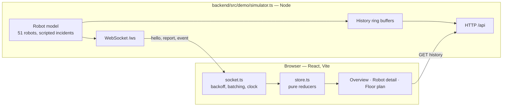
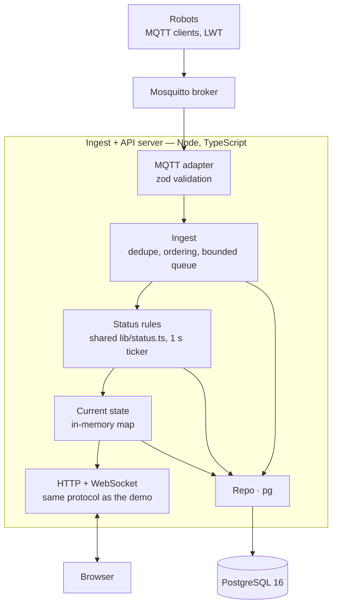

# Fleet Monitor — System Design

> Status: Draft v5 · Author: Pritom Mazumder · Date: 2026-11-09
> Scope: Olivaw Engineering Challenge — user interface, robot simulator, server side.

This document has two parts:

- **Part A** describes the demo: the interface plus an in-process mock backend (`npm run dev`).
- **Part B** describes the production design: MQTT, an ingest server and PostgreSQL. It keeps every rule from Part A and replaces the mock with real infrastructure. Part B is now built too (`docker compose up`). Where the build differs from or adds to the first draft, the section says so.

[Section 3](#3-demo-vs-production) maps the two parts. Where they differ, the reason is given.

### Repository layout

```
shared/     @fleet/shared — the code both sides must agree on
  src/protocol.ts     browser wire protocol (§6)
  src/status.ts       the status model and the freshness clock (§4)
  src/telemetry.ts    MQTT topics and zod payload schemas (§10–11)
  src/sites.ts        floor plans, used for drawing and for robot movement
frontend/   React + Vite client (§7)
backend/
  src/demo/simulator.ts   Part A mock backend
  src/sim/fleet.ts        robot model and scripted incidents, used by both backends
  src/sim/mqtt-robots.ts  one MQTT client per robot (Part B)
  src/sim/seed.ts         migrations + robot registry
  src/server/             Part B ingest + API server (§9)
  src/ops/pki.ts          dev CA, broker/server/robot certificates, broker ACL from the registry (§16)
  src/load/loadtest.ts    load generator and report (§17)
  migrations/             SQL (§13)
e2e/        Playwright browser tests against the demo backend (§17); playwright.config.ts at the root
lint/       ESLint config with its own install, not a workspace (§7, how the standard is enforced)
.github/workflows/ci.yml   every check on every push and pull request
deploy/mosquitto.conf, deploy/mosquitto.secure.conf, Dockerfile,
docker-compose.yml (plain), docker-compose.secure.yml (TLS override)
```

npm workspaces link the three packages. `@fleet/shared` is consumed as TypeScript source by Vite (client) and tsx (server), so there is no build step for it.

---

## Table of contents

1. [Context](#1-context)
2. [Goals and non-goals](#2-goals-and-non-goals)
3. [Demo vs. production](#3-demo-vs-production)
4. [Status model](#4-status-model)

**Part A — Built system**

5. [Architecture (demo)](#5-architecture-demo)
6. [Wire protocol](#6-wire-protocol)
7. [Client data layer](#7-client-data-layer)
8. [Simulator](#8-simulator)

**Part B — Production design**

9. [Architecture (production)](#9-architecture-production)
10. [MQTT design](#10-mqtt-design)
11. [Telemetry contract](#11-telemetry-contract)
12. [Ingest pipeline](#12-ingest-pipeline)
13. [Storage](#13-storage)
14. [API](#14-api)
15. [Failure modes](#15-failure-modes)
16. [Observability and security](#16-observability-and-security)

**Both**

17. [Testing](#17-testing)
18. [Decisions](#18-decisions)
19. [What I disagree with](#19-what-i-disagree-with)
20. [Open questions](#20-open-questions)

---

## 1. Context

Robots work at several warehouse sites. Each robot reports its state about once per second: battery, position, task and error state. The user is a fleet manager. They want to answer one question in under 3 seconds: **"Which robots need my attention right now?"**

The interface is the main part of the submission. The server exists to make the interface truthful: fresh, correct "now" data, and an honest signal when data is not fresh.

---

## 2. Goals and non-goals

### Goals

- G1. Show the current status of every robot. A new report reaches the screen within 1 s.
- G2. Mark a robot `offline` when it has not reported for more than 10 s.
- G3. Never mark a robot `offline` because **our own** link (browser ↔ server, or server ↔ broker) is down.
- G4. Show one robot's recent history: battery for 15 min, position trail for 4 min, events for today.
- G5. Keep one status model, one source of truth, used by the server and the client.
- G6. Document each trade-off and the condition that would change it.

### Non-goals

- Exactly-once delivery of telemetry.
- Commands to robots (the topic is reserved, the flow is not built).
- User accounts, roles and multi-tenancy.
- Mobile layout.

---

## 3. Demo vs. production

| Concern | Demo (built) | Production (designed) | Why the demo is enough |
|---|---|---|---|
| Robots → server | In-process simulator | MQTT via a Mosquitto broker | The client cannot tell the difference. The wire protocol to the browser stays the same. |
| Server → browser | WebSocket `/ws` | WebSocket `/ws` (same protocol) | No change. |
| Current state | Memory of the simulator process | Memory of the ingest server, written through to Postgres | One process, no restarts to survive. |
| History | Ring buffers in memory (15 min battery, 4 min trail, 80 events per robot) | Postgres, partitioned by day | The detail page only needs recent history. |
| Status rules | `shared/src/status.ts`, used by the client and the demo model | The same module, used by the ingest server | — |
| Run | `npm run dev` | `docker compose up --build` (or `npm run infra` + `npm run dev:prod` from source) | One command in both cases. |
| Fleet size | 51 robots, 4 sites (one empty) | Target 1,000 robots | — |

The browser does not know that the backend is a mock. Swapping the simulator for the production server changes no client code.

---

## 4. Status model

One model, used everywhere: the table, the cards, the map, the detail page, the headline and the event log.

```ts
type Status = 'ok' | 'low' | 'error' | 'offline' | 'never';
```

| Status | Rule (first match wins) | Meaning for the manager |
|---|---|---|
| `never` | Registered, no report yet | Unknown, but expected. Not counted as "needs attention". |
| `offline` | Last report more than 10 s ago | **We do not know.** Not "it broke". |
| `error` | Robot reports `state = 'error'` | Something broke. |
| `low` | Battery below 20 % | Needs to charge soon. |
| `ok` | All other cases | Quiet. |

Severity for sorting: `offline → error → low → never → ok`, then by ID.

### Rules that keep the model honest

- **Freshness uses one clock.** `statusClock()` returns the current server time while the link is live. When the link is lost, it returns the time of the last message received. So, a robot can turn `offline` only on evidence about the robot, never on evidence about our own link.
- **"Last seen" keeps counting** while the link is down. The manager sees staleness grow, but robot statuses do not change.
- **Offline wins over error and low.** An offline robot's last battery value is still shown, labelled *last known*.
- **The sort key uses only status and ID.** A battery or position update never moves a row.

### Production change: battery hysteresis

With 1 Hz reports, a battery near 20 % can flap between `low` and `ok`. So, a robot **enters** `low` below 20 % and **leaves** it at 22 % or more. The entry threshold stays 20 %, so the dashed line on the chart stays true.

Because the rule lives in the shared module, the demo and the client apply it too: `nextLow(battery, wasLow)` keeps a per-robot latch, and `deriveStatus(report, at, low)` reads it. The event text is "Battery back above 22%".

Known edge: the browser starts its latch from the `hello` snapshot. A robot at 20–21 % that the server holds as `low` shows `ok` in a freshly opened tab until it crosses 22 % or drops under 20 %. Closing it means sending the latch in `Report`. It has not been worth a protocol change yet.

---

# Part A — Built system

## 5. Architecture (demo)



| Path | Purpose |
|---|---|
| `ws /ws` | `hello` on connect, then one `report` per robot per second, and `event` on each transition |
| `GET /api/robots/:id/history` | Battery (15 min, every 5 s), trail (4 min, every 2 s), the last 40 events |
| `GET /api/health` | Robot and client counts |
| `POST /control/outage?seconds=N` | Drops all sockets and refuses new ones for N seconds. Demo only. |

With `STATIC_DIR` set (`npm run start:demo`), the same process also serves the built client.

---

## 6. Wire protocol

Defined in `shared/src/protocol.ts`. All timestamps are **server** epoch milliseconds.

```ts
type ServerMessage =
  | { type: 'hello'; serverTime: number; robots: RobotInfo[]; reports: Report[]; ingest?: Ingest }
  | { type: 'report'; r: Report }
  | { type: 'event'; e: RobotEvent }
  | { type: 'ingest'; ingest: Ingest }            // the ingest state changed after hello (§14)
  | { type: 'heartbeat'; serverTime: number };    // every 2 s

interface Ingest { state: 'live' | 'paused'; frozenAt: number | null }

interface RobotInfo {           // registry, sent once per connection
  id: string; model: string; modelFull: string; siteKey: string;
  firmware: string; network: string; registeredAt: number;
  lastCharge: [start: number, end: number] | null;
}

interface Report {              // about 1 per robot per second
  id: string; t: number; battery: number; x: number; y: number;
  state: 'ok' | 'error';        // "offline" is never reported; it is derived
  fault?: string; task: string; since: number;
}

interface RobotEvent {
  id: string; t: number;
  kind: 'info' | 'low' | 'warn' | 'error' | 'off' | 'ok';
  text: string; sub?: string;
}
```

### Why a heartbeat

The client's stall watchdog treats 5 s of silence on an open socket as a dead link. Before Part B, reports always flowed, so silence meant a dead link. With ingest paused (or every robot offline), no reports flow while the link is healthy. A heartbeat every 2 s keeps the watchdog honest. It also advances `lastMessageAt`, so a later connection loss freezes the clock at the right time.

### Why `hello` is a full snapshot

On every connect and reconnect the server sends the whole registry and the last report of each robot. There is no replay of missed messages. The snapshot is small (one entry per robot), always correct, and removes a whole class of reconnect bugs. A robot without a report in `hello` is `never`.

---

## 7. Client data layer

All paths are under `frontend/src/`.

| File | Responsibility |
|---|---|
| `data/socket.ts` | Opens the socket. Reconnects with backoff 1, 2, 5, 10 s and shows the attempt count. A 5 s stall watchdog treats a silent open socket as dead. **Validates every frame** against the zod `ServerMessage` schema from `@fleet/shared/protocol`: a malformed frame is dropped and warned about once per type, and an unknown `type` (a newer server) is ignored. Applies reports in 250 ms batches, so the store changes about 4 times per second, not 50. Runs **the one clock**: a single `setInterval(1000)` aligned to the second. The watchdog runs *before* the clock advances, so after a laptop wakes, a dead socket is noticed before any robot can look silent. Handles `ingest` and `heartbeat`. |
| `data/store.ts` | Pure reducers (`applyHello`, `applyReports`, `applyTick`, `applyLost`, `applyIngest`, `applyHeartbeat`, `applyEvent`) and a small `useSyncExternalStore` store with selector equality. Each reducer re-derives status. A status change stamps `changedAt`, which drives the 1.8 s row highlight. |
| `data/types.ts` | `Robot` is a discriminated union: `{ status: 'never', report: null } \| { status: ReportedStatus, report: Report }`. Checking one narrows the other, so no code asserts `report!`. |
| `data/history.ts` | Fetches history on open, every 10 s and after a reconnect, and **validates it** with the `RobotHistory` schema. Extends the trail from live reports through a store subscription. Merges live events into history by `eventId`. |
| `lib/status.ts` | Re-exports `@fleet/shared/status`. Adds `statusClock()` (frozen while our link is lost **or** ingest is paused), `isStale()`, and colours. |
| `lib/sort.ts` | Sort by severity, then ID. |
| `components/Clock.tsx` | `<Ago>` and `useWithin()`: the leaves that read the clock themselves ([render cost](#render-cost)). |
| `components/ErrorScreen.tsx` | The crash screen, the router's `errorElement` and the top-level error boundary ([failure inside the client](#failure-inside-the-client)). |

### Clock offset

`hello` carries `serverTime`. The client stores `offset = serverTime − Date.now()` and keeps `now` in server time. So, a wrong laptop clock does not make robots look offline.

### Hover sync

One `hover` value in the store. Table rows, cards, map pins and floor-plan list items read and write it.

### Logic reads codes, never display text

The protocol carries each meaning twice: a code for logic and a text for people. The client branches only on the code.

| Field | Used for | Never used for |
|---|---|---|
| `Report.taskKind` (`picking`, `returning_to_dock`, `waiting_for_dock`, `charging`, `idle`, `other`) | The low-battery plan on the detail page ("It is on its way to charge"), the charging icon, "Charging in the dock" | `Report.task` is shown as is and may change wording at any time |
| `RobotEvent.code` and `bay` | Which bay a returning robot is heading to (`bay_assigned`) | `text` and `sub` are shown as is |
| `RobotEvent.eventId` | Merging live events with history, and React keys | `t + text` is not unique and changes with wording |

An unknown code from a newer server reads as `other` (`.catch('other')` in the schema), so an old client degrades to plain text instead of dropping the message.

### Render cost

Target: 1,000 robots in one view (Part B).

- **Robot data reaches the store at most about 4 times a second** (the report batches), and the clock once a second.
- **A tick does not re-render rows or markers** (a render-count test proves it for rows). Rows and map markers are `memo` components and do not take `now` as a prop. The text that depends on time ("3 s ago", the row highlight) lives in leaves (`<Ago>`, `useWithin`) that subscribe to the clock and re-render only when their own output changes.
- **A report batch re-renders only the rows whose robot changed.** Reducers keep the object identity of every robot that did not change, and `RobotTable` hands each row a stable ref callback, so `memo` holds.
- **Known cost:** `Overview` itself subscribes to `now` for the attention cards (at most 8), so the page component re-renders once a second. Its derived lists are memoized on the robot map and do not recompute on a tick.
- **Not measured yet:** there is no browser profile at 1,000 robots, and the table is not virtualized. *Change when:* a React Profiler commit on the overview passes 16 ms at the target fleet size → virtualize the table, and move the attention cards onto `<Ago>`.

### Failure inside the client

A control-room screen must never go blank: an empty page looks like an empty fleet.

- **A page that throws while rendering** is caught by the root route's `errorElement`. It shows "This view stopped working" with Reload, a link to the overview and the error message, and logs to the console.
- **Anything above the routes** is caught by `AppErrorBoundary`, which shows the same screen.
- The socket and the clock run outside React, so they survive both. The crash screen uses no router hooks and no top bar, because either could be what failed.
- **Not built:** a boundary per panel (a map that throws takes the table down with it), and automatic recovery. A reload loop on a wall display is worse than a visible error.

### How the standard is enforced

| Check | Command | Catches |
|---|---|---|
| Types | `npm run typecheck` (TypeScript 7, `strict`) | Vitest does not type-check, so this is the only gate for types. It caught the half-finished `taskKind` / `eventId` change. |
| Lint | `npm run lint` (ESLint 10, `--max-warnings 0`) | `react-hooks` with the React Compiler rules (rules of hooks, exhaustive deps as an error, set-state-in-effect, purity, refs), `typescript-eslint` recommended, no non-null assertions in app code, `eqeqeq` |
| Unit and component tests | `npm test` | See [section 17](#17-testing) |
| Coverage | `npm run test:coverage` | Fails below 95 % lines, statements, functions and branches |
| Browser flows | `npm run test:e2e` | See [section 17](#17-testing) |

CI (`.github/workflows/ci.yml`) runs all of them on every push and pull request.

ESLint has its own package in `lint/`, with its own lockfile (`npm run lint:install`). typescript-eslint parses with the TypeScript 6 compiler API, and TypeScript 7 has no such API. As a workspace, npm would hoist part of the lint toolchain next to TypeScript 7, and it would break. Lint therefore uses no rule that needs type information; `tsc` covers types.

---

## 8. Simulator

The robot model lives in `backend/src/sim/fleet.ts`. Two runners use it:

- `backend/src/demo/simulator.ts` (Part A) runs it in process and sends reports straight to browsers.
- `backend/src/sim/mqtt-robots.ts` (Part B) opens one MQTT client per robot. Each client has an LWT, a boot counter and a seq number, and a configurable clock skew (`CLOCK_SKEW_MS`). `ROBOTS=1000` adds load-test robots.

Each model event has an origin. `robot` events (task, charging, fault, Wi-Fi) are published by the MQTT robots. `server` events (low, ok, off) are status transitions: only the demo emits them from the model, and in Part B the ingest server derives them.

Model behaviour:

- 50 robots across Hamburg DC, Leipzig Hub and Munich North, plus `R-051`, registered but never reported. Berlin South has no robots, so the empty state is real data.
- On start, it simulates the previous 15 minutes, so charts and trails have data at once.
- Robots work along aisles, drain battery, return to dock below a threshold, and charge.
- Each robot reports at its own offset inside the second, like real radios.
- Randomness is seeded, so every run is the same.

### Scripted incidents

In the demo, incidents happened before start, so the dashboard opens with them. In MQTT mode (`incidents: 'live'`), they happen shortly after start, so a fresh server and database watch them happen: R-024 faults at +8 s, R-041 warns at +20 s and drops its link at +45 s (the broker publishes its LWT), and R-009 goes silent at +35 s while staying connected.

| Robot | Incident | Shows |
|---|---|---|
| R-009 | Stopped reporting 34 s before start | Offline, short |
| R-041 | Stopped reporting 3 min before start, after a weak Wi-Fi warning | Offline, long; the event log explains why |
| R-017 | 14 %, returning to dock | Low battery, detail page |
| R-032 | 9 %, all charging bays busy; a dock frees up after 10 min | Low battery, then recovery |
| R-024 | "Motor overcurrent" | Error |
| R-028 | Drops below 20 % about 7 s after start | Status-change highlight |
| R-051 | Registered, never reported | `never` state |
| all | `npm run outage` drops every socket for 20 s | Connection-lost banner, frozen statuses |

---

# Part B — Production design

## 9. Architecture (production)



### Code layout (`backend/src/server/`)

| Module | Role |
|---|---|
| `transport/mqtt.ts` | Connects, subscribes `fleet/+/+/#` (or `fleet/{site}/#` per `SITES`), parses topics, validates with zod |
| `domain/seqWindow.ts` | `(boot, seq)` dedupe window |
| `domain/fleet.ts` | Current state, status derivation, transition events, the ingest clock. Pure. |
| `persist/batchWriter.ts` | Bounded queue + batch writer, timers injected |
| `repo/pg.ts` | Migrations, partitions, writes, history queries |
| `http/server.ts`, `http/fanout.ts` | Routes, problem+json, HTTPS, WebSocket coalescing, the slow-client policy |
| `metrics.ts`, `log.ts` | prom-client, pino with sampling |
| `app.ts` | `createApp(config)`: wiring, the 1 s ticker, registry refresh, shutdown. Tests and the load test start it in process. |
| `main.ts` | Reads the environment (`config.ts`, fails fast on half-set TLS), handles signals |

### Layer rule

- Only `transport/mqtt` imports `mqtt`. Only `repo/` imports `pg`. Only `http/` knows about HTTP (plain `node:http` + `ws`; no framework was needed).
- `domain/` is pure. It gets the clock by injection, so tests use a fake clock and never sleep.
- The status rules are the **same module** the client uses. Server events and client pills can therefore never disagree.

---

## 10. MQTT design

### Topics

| Topic | Direction | QoS | Retained | Purpose |
|---|---|---|---|---|
| `fleet/{siteId}/{robotId}/telemetry` | robot → server | 0 | no | Reports at 1 Hz |
| `fleet/{siteId}/{robotId}/event` | robot → server | 1 | no | Task started or completed, fault raised, Wi-Fi warning |
| `fleet/{siteId}/{robotId}/status` | robot / broker → server | 1 | yes | `online` on connect. LWT `offline` on unclean disconnect. |
| `fleet/{siteId}/{robotId}/cmd`, `…/cmd/ack` | both | 1 | no | Reserved for commands. Not built. |

- **Telemetry uses QoS 0.** The newest sample wins, so resending an old one has no value.
- **Events use QoS 1.** They are rare, and the timeline must not miss "Task started".
- **The LWT is a hint, not proof.** It makes offline detection fast after a crash. A robot can stay connected and send nothing, so the 10 s rule stays the source of truth.
- **Sessions:** `clean: true` for robots and the server. Keepalive 10 s.

### Subscriptions and scaling

One server instance subscribes to `fleet/+/+/#`.

MQTT shared subscriptions (`$share/…`) are **not** the scaling path. They hand each message to any member of the group, not to the same member per robot. That would break per-robot state and dedupe. The scaling path is to partition by site: each instance subscribes to `fleet/{siteId}/#` for its own sites, with no shared group. See [section 18](#18-decisions), D5.

---

## 11. Telemetry contract

The MQTT payload is the demo `Report` plus the fields a real network needs. Zod schemas live in one shared package.

```ts
const Telemetry = z.object({
  id: z.string().min(1).max(64),
  siteId: z.string().min(1).max(64),
  boot: z.number().int().nonnegative(),   // boot counter, +1 on each restart, stored on the robot
  seq: z.number().int().nonnegative(),    // +1 per message, reset to 0 on boot
  robotTs: z.number().int(),              // robot clock, epoch ms; stored, never used for ordering
  battery: z.number().min(0).max(100),
  x: z.number(), y: z.number(),
  state: z.enum(['ok', 'error']),
  fault: z.string().max(128).optional(),
  task: z.string().max(128),
  since: z.number().int(),
});
```

The server turns each accepted sample into a `Report` for the browser, with `t = receivedAt` (server clock). The browser protocol does not change.

Two fields fix gaps in the earlier draft:

- **`boot` is an ordered counter, not a UUID.** "Newer" means a greater `(boot, seq)`, and a UUID has no order.
- **`robotTs` is separate from `t`.** Freshness and ordering never use the robot clock. The skew `receivedAt − robotTs` is stored per sample, smoothed per robot (EWMA, α = 0.1, about 10 s of memory), sent as `Report.skew` (ms), and shown in the detail page's Details as "Robot clock · 1.4 s behind the server". Under 0.5 s reads "In sync", because the value includes network transit. It is plain text, not a status colour: it explains odd timestamps, it is not a problem for the manager.

---

## 12. Ingest pipeline

### Steps per message

```
MQTT message
  → parse + zod validate      fail     → count invalid, drop (log sampled)
  → registry check            unknown  → count unknown, drop
  → dedupe (boot, seq)        seen     → count duplicate, drop
  → order check               older    → history only, never current state
  → update current state + derive status + emit events   (synchronous, in memory)
  → push Report to WebSocket clients
  → enqueue for persistence   full     → drop oldest, count dropped
```

Current state is updated **before** the persistence queue. A slow database can create gaps in history. It can never make the live view wrong.

### Dedupe and ordering

- Per robot, the server keeps the newest `(boot, seq)` and a 256-entry bitmap of recent `seq` values for that boot.
- A greater `boot` resets the window.
- `robot_state` stores the newest `(boot, seq)`, so ordering survives a server restart.
- After a restart, the bitmap is empty, so a rare duplicate can reach history. This is accepted: history is aggregated per bucket, and a repeated sample does not change a line chart. QoS 0 means the broker never redelivers. Duplicates come only from robot-side retries.

### Status derivation and the ingest clock

A 1 s ticker re-derives status for all robots, because `offline` is a function of time.

The ticker uses the same rule as the client's `statusClock()`:

- While the MQTT connection is up, freshness is judged against the current time.
- While it is down, freshness is frozen at the last message received from the broker.

So, a broker outage shows as "ingest paused" on the dashboard. It does not mark 1,000 robots offline and fill the event log with false "Went offline" events.

Two additions came out of running the build:

- **Settle window (3 s).** When the broker link returns, freshness stays frozen for 3 s while robots report again. Without it, the first tick after a reconnect sees every last report as minutes old and marks the whole fleet offline for a second. Browsers see `paused` until the window ends.
- **Stall watchdog (5 s).** If the link is "up" but no robot at all has sent anything for 5 s, the silence is treated as evidence about our own path, not about every robot. The ingest state goes to `paused` with freshness frozen, and the settle window runs when data resumes. This was found in testing: over two days of a laptop sleeping and waking, the ticker woke before MQTT noticed the dead TCP link and logged about 4,900 false "Went offline" / "Back online" pairs. A `SIGSTOP`/`SIGCONT` test now produces none. Trade-off: if every robot in the fleet really goes silent at once (one broker, one power cut), the dashboard says "Robot data paused", not "all offline". Both mean "we do not know".

### Bounded queue and batch writer

- Capacity: 50,000 samples (about 50 s at 1,000 msg/s).
- Flush at 1,000 rows or every 500 ms, one flush at a time.
- Insert with one multi-row `INSERT … SELECT FROM unnest(…)`.
- On a database error: retry with backoff (100 ms to 5 s). When the queue fills, drop the oldest samples. A full batch pulls a pending timed flush forward.
- A batch that fails with a SQL error a retry cannot fix (SQLSTATE class 21, 22, 23 or 42) is dropped and counted, not retried forever. One poison batch must not block a queue. Found by the integration test: a state batch built up during a database outage held several rows for one robot, and `INSERT … ON CONFLICT` refused it on every retry, so state writes and readiness stayed red after the database came back. `upsertStates` now also keeps one row per robot.
- Every query has a 10 s client-side timeout. A database that *hangs* (rather than refusing connections) must fail the write, so the writer retries and readiness turns red.
- A row for a day with no partition fails with `23514`. The writer then creates partitions and retries once. Partition maintenance also runs when the database becomes reachable again. Without this, a database that was down over midnight would block the telemetry queue until the next hourly run.
- `robot_state` is upserted at most once per second per robot. Events are inserted immediately.
- The registry is re-read every 15 s (`REGISTRY_REFRESH_MS`). New robots appear as `never`, retired ones disappear, and browsers get a fresh `hello`. State rows for a robot removed in the meantime are skipped (join with `robots`), not failed.

---

## 13. Storage

### Schema

```sql
CREATE TABLE robots (                      -- the registry; needed for "never reported"
  id            text PRIMARY KEY,
  site_id       text        NOT NULL,
  model         text        NOT NULL,
  model_full    text        NOT NULL,      -- added in the build: the detail page shows it
  firmware      text        NOT NULL,
  network       text,
  registered_at timestamptz NOT NULL
);

CREATE TABLE telemetry (
  robot_id     text        NOT NULL,
  boot         integer     NOT NULL,
  seq          bigint      NOT NULL,
  received_at  timestamptz NOT NULL,
  robot_ts     timestamptz NOT NULL,
  battery      real        NOT NULL,
  x            real        NOT NULL,
  y            real        NOT NULL,
  state        text        NOT NULL,
  fault        text,
  task         text        NOT NULL
) PARTITION BY RANGE (received_at);

CREATE INDEX telemetry_robot_time ON telemetry (robot_id, received_at DESC);

CREATE TABLE robot_state (
  robot_id     text PRIMARY KEY REFERENCES robots(id),
  report       jsonb       NOT NULL,       -- last Report
  boot         integer     NOT NULL,
  seq          bigint      NOT NULL,
  status       text        NOT NULL,
  last_seen_at timestamptz NOT NULL
);

CREATE TABLE robot_events (
  id        bigint GENERATED ALWAYS AS IDENTITY PRIMARY KEY,
  robot_id  text        NOT NULL,
  t         timestamptz NOT NULL,
  kind      text        NOT NULL,          -- info | low | warn | error | off | ok
  text      text        NOT NULL,
  sub       text
);

CREATE INDEX robot_events_robot_time ON robot_events (robot_id, t DESC, id DESC);   -- keyset pagination
```

There is no unique constraint on `(robot_id, boot, seq)`. Postgres requires every unique key on a partitioned table to include the partition key `received_at`. A resent sample has a new `received_at`, so such a constraint would never catch it. Dedupe happens in memory ([section 12](#dedupe-and-ordering)).

### Partitions and retention

- Partitions are daily, by `received_at`, which is the server clock. A robot with a bad clock cannot write into the wrong partition.
- A job runs on startup and every hour. It creates partitions for the next 2 days and drops partitions older than 7 days. Dropping a partition is instant. A `DELETE` of millions of rows is not.

### Capacity at 1,000 robots

| Metric | Estimate |
|---|---|
| Messages per second | 1,000 |
| Rows per day | 86.4 M |
| Bytes per row, with tuple header and index | ~~200–250 B~~ **157–161 B measured** |
| Storage per day | ~~17–22 GB~~ **about 14 GB** |
| 7-day retention | ~~120–150 GB~~ **about 97 GB** |

The struck values were the first estimates; the bold ones come from the load test (`docs/LOAD_TEST.md`, 4 M rows).

### History query

The detail page asks for a time range. The server picks a bucket so the response has at most 500 points:

```sql
SELECT date_bin($bucket, received_at, $from) AS t,
       min(battery)                                        AS battery_min,
       avg(battery)                                        AS battery_avg,
       (array_agg(x ORDER BY received_at DESC))[1]         AS x,
       (array_agg(y ORDER BY received_at DESC))[1]         AS y
FROM telemetry
WHERE robot_id = $1 AND received_at >= $from AND received_at < $to
GROUP BY 1 ORDER BY 1;
```

Position uses the **last** value in each bucket, not the average. The average of two positions can be a point inside a rack.

Gaps stay gaps. A bucket with no rows returns no point, so the chart shows "No data since 14:00:08" and does not invent a line.

---

## 14. API

The browser contract from Part A stays. Production adds range queries.

| Method | Path | Purpose |
|---|---|---|
| WS | `/ws` | `hello` snapshot, then `report` and `event`. Same as the demo. |
| GET | `/api/robots/:id/history` | Default ranges, same as the demo (15 min battery, 4 min trail, today's events) |
| GET | `/api/robots/:id/telemetry?from&to` | Downsampled history, at most 500 points, range at most 7 days |
| GET | `/api/robots/:id/events?from&to&cursor` | Event timeline, paginated |
| GET | `/healthz` | The process is up |
| GET | `/readyz` | The database and broker are connected, and state is loaded |
| GET | `/metrics` | Prometheus; needs `Authorization: Bearer $METRICS_TOKEN` when that is set |

Errors use `application/problem+json` (RFC 9457).

### WebSocket fan-out

- Reports are coalesced per client to at most one per robot per second.
- If a client's send buffer passes 1 MB, the server keeps only the newest report per robot for it. If the buffer does not drain, the server closes the socket. The client reconnects and gets a fresh `hello`.

### `hello` in production

`hello` gains `ingest: { state: 'live' | 'paused', frozenAt }`, and an `ingest` message carries later changes. When the server has lost the broker (or the link stalled), the client shows "Robot data paused" in the top-bar indicator and the banner. Statuses stay frozen at `frozenAt`, values are marked stale, and "last seen" keeps counting.

`/api/robots/:id/events` uses an opaque keyset cursor over `(t, id)`. `from` and `to` accept epoch ms or ISO 8601.

---

## 15. Failure modes

| Failure | Behaviour | Data impact |
|---|---|---|
| Browser ↔ server link lost | Banner, values turn grey, "last seen" keeps counting, statuses frozen. Reconnect with backoff, then a fresh `hello`. | None |
| Server ↔ broker link lost | `ingest: paused` sent to clients. Status clock frozen. No false offline events. | No data during the outage |
| One robot goes silent, still connected | `offline` after 10 s, from the ticker | None |
| One robot crashes | LWT arrives after about 15 s; the 10 s rule usually fires first | None |
| Robot reboots | Greater `boot` resets the dedupe window | None |
| Duplicate sample | Dropped by the window. After a server restart, a rare duplicate can reach history. | None visible |
| Reordered sample | History only | None |
| Robot clock skew | Ordering uses `(boot, seq)`; freshness uses server time; skew is shown | None |
| Invalid payload | Dropped, counted, logged with sampling | That sample |
| Database slow or down | Queue grows, then drops the oldest. `/readyz` fails. Live view continues from memory. History endpoints return 503. | Gaps in history |
| Server crash | Queue content lost: under 1 s at normal load, up to 50 s if the database was slow. On restart, state loads from `robot_state`. | Gap in history |
| Slow browser | Coalesced, then disconnected | None for other clients |
| Server process suspended (laptop sleep), or a stalled link the keepalive has not caught | Stall watchdog: 5 s with no robot data → `paused`, frozen clock, settle window on resume | None |
| Database down over midnight | Insert hits a missing partition → partitions created, batch retried | None |
| Database hangs (not refusing) | Queries time out after 10 s → writes retried, `/readyz` red, live view continues | None if it returns within the queue's capacity |
| A batch the database can never accept | Dropped and counted after the first failure; the queue continues | That batch |

---

## 16. Observability and security

### Metrics

| Metric | Meaning |
|---|---|
| `ingest_messages_total{result}` | `accepted`, `invalid`, `unknown`, `duplicate`, `out_of_order` |
| `ingest_dropped_total` | Dropped because the queue was full |
| `ingest_queue_depth` | Current queue size |
| `ingest_lag_seconds` | `received_at − robot_ts` |
| `db_batch_write_seconds` | Duration of each batch |
| `robots_by_status{status}` | Current counts |
| `ws_clients`, `ws_disconnects_total{reason}` | Browser connections |
| `mqtt_connected` | 1 or 0 |

Logs: `pino`, JSON, one line per event, request IDs. High-volume warnings are sampled.

### Security

| Area | Demo / plain stack | Production (built: `docker-compose.secure.yml`) |
|---|---|---|
| Robot auth | None | mTLS, one certificate per robot (CN = robot ID). Mosquitto maps the CN to the ACL user (`use_identity_as_username`). The ACL is generated from the registry, so each robot can publish only to `fleet/{its site}/{its id}/…`, and only the ingest server's certificate can read `fleet/#`. |
| Transport | Plain HTTP and WS, MQTT on 1883 | MQTT over TLS only (8883, TLS ≥ 1.2, no plaintext listener), HTTPS/WSS with HSTS |
| User auth | None | None: user accounts are a non-goal (§2). Every viewer sees every site, so the dashboard belongs on a trusted network or behind an authenticating proxy. |
| WebSocket | Open | Open, over WSS |
| Metrics | Open | Bearer token (`METRICS_TOKEN`), compared in constant time |
| Control endpoints | `/control/outage` (demo only) | Not present in the ingest server |
| Input validation | zod at the MQTT boundary | Same |

How the pieces are issued:

- `backend/src/ops/pki.ts init` creates a development CA and the broker, ingest-client and web certificates (EC P-256, OpenSSL 3 or LibreSSL). `pki.ts robots` issues a certificate per registered robot and writes the ACL; re-run it after provisioning and send the broker `SIGHUP`. In production, certificates come from the company PKI; the ACL generator stays.

Not built: certificate revocation (CRL/OCSP) for a stolen robot. Today the answer is to remove the robot from the registry, which removes it from the ACL at the next `pki.ts robots` + `SIGHUP`.

---

## 17. Testing

### Built

| Test | What it proves |
|---|---|
| `frontend/src/lib/sort.test.ts` | Battery and position updates never change row order. Only a status change does. |
| `frontend/src/lib/status.test.ts` | The status model rules. A lost connection never marks robots offline, and "last seen" keeps counting. Hysteresis 19 ↔ 22 %. Ingest paused freezes freshness. Relative time format. |
| `frontend/src/data/store.test.ts` | Every reducer and action. A failed first connection stays "connecting". A reconnect `hello` keeps the previous status, latch and trail, so a change during an outage is highlighted. The heartbeat clock only moves forward; the live event log keeps the newest 300. Hover changes only when its target changes. `useFleet` re-renders only when the selected slice changes. |
| `frontend/src/data/socket.test.ts` | With a fake WebSocket and fake timers: `ws` or `wss` on the same host. `hello`, batched reports, events, ingest and heartbeats reach the store; reports buffered before a fresh `hello` are dropped. Frames that are not JSON or fail the schema are dropped with one warning per type; unknown types are ignored. Backoff 1, 2, 5, then 10 s, keeping the data. A socket silent for 5 s is dropped, not sooner. "Retry now". |
| `frontend/src/data/history.test.ts` | Loads once the link is live, then every 10 s. A response that fails the schema is an error, not data. A failed refresh keeps loaded data. The live trail every 2 s, kept for 4 minutes. Live events merged newest first, deduplicated by `eventId` (not time and text). Battery rate and the 20 % crossing. |
| `frontend/src/lib/fleet.test.ts`, `time.test.ts`, `theme.test.tsx` | Headline sentences for every state, search, site visibility; time formats; theme follows the system until picked |
| `frontend/src/components/RobotTable.render.test.tsx` | Render counts: a hover re-renders two rows, a clock tick none, a report only that robot's row ([render cost](#render-cost)) |
| `frontend/src/components/*.test.tsx` | Each component in every status: pill, battery glyph, attention cards, filter pills, site plan, search (the `/` shortcut), map markers and popovers, battery chart, table rows and the status-change highlight, top bar, both banners. The crash screen, from a route and from the top-level boundary. |
| `frontend/src/pages/*.test.tsx`, `App.test.tsx` | Overview, robot detail, floor plan and component sheet rendered from fixture states built with the real reducers: loading, empty site, no results, connection lost, ingest paused, never reported; the low-battery plan from `taskKind`, the bay from `bay_assigned`; routing and not found |
| `backend/src/server/domain/fleet.test.ts` | Dedupe window, boot reset, order check, server-time stamping, unknown robot and wrong site, hysteresis events, offline once, frozen clock while the broker is down, settle window, stall watchdog, state restored after restart |
| `backend/src/server/persist/batchWriter.test.ts` | Flush by size or time, drop oldest when full, retry with backoff in order, one flush at a time |
| `backend/src/server/http/fanout.test.ts` | One report per robot per second, newest wins, slow client held then cut, fast clients unaffected |
| `backend/src/server/pipeline.int.test.ts` | Real Postgres 16 + Mosquitto 2 (Testcontainers). A published sample reaches a WebSocket client in < 1 s (G1) and is stored with server time and skew. Duplicates dropped, late samples in history only. LWT logged, then offline by the 10 s rule. Partitions created ahead and dropped after retention. History ≤ 500 points with last-position buckets and gaps kept. Event pagination. Registry change → fresh `hello`. A *paused* (hung) database: live view continues, `/readyz` red, history 503, then recovery with nothing queued lost. |
| `backend/src/server/security.int.test.ts` | TLS broker with the generated ACL: no certificate refused, a foreign CA refused, a robot cannot publish for another robot. HTTPS with HSTS, no sign-in routes, every robot streamed over WSS, metrics token. |

Run with `npm test` (unit and component, 238 tests, 134 of them in the client) and `npm run test:int -w backend` (integration, 20 tests, needs Docker). `npm run test:coverage` runs both with the thresholds; the client is at 99.9 % lines and 97.6 % branches.

### Load test (built)

`backend/src/load/loadtest.ts`, run inside the Docker network; full results in [`docs/LOAD_TEST.md`](LOAD_TEST.md). Apple M1, Docker VM with 8 CPUs shared by generator, broker, server and Postgres:

| Robots × Hz | Accepted/s | Ingest lag p99 | Queue max | Dropped | Server CPU |
|---|---|---|---|---|---|
| 1,000 × 1 | 1,000 | 18.8 ms | 481 | 0 | 15 % |
| 5,000 × 1 | 5,004 | 22.2 ms | 494 | 0 | 31 % |
| 5,000 × 4 | 19,918 | 156.3 ms | 17,798 | 0 | 56 % |
| 5,000 × 1, database paused 30 s | 4,987 | 191.9 ms | 50,000 (full after 10 s) | 101,247 | 34 % |

The first drop point is the database, not load: drops start when the database is away for longer than capacity ÷ rate (50 s at 1,000 msg/s), and the live view does not move. The main flows were checked by hand in Chrome at 1440 px and 1024 px, in both themes.

Checked by hand against the running stack (Postgres 16, Mosquitto 2): migrations and partitions; restart with state reload; graceful shutdown; broker stop and start (banner, zero false offline events); `SIGSTOP` for 30 s; two days with the database and broker gone, then recovery; history, range and paginated event endpoints; problem+json errors.

### End to end (built)

`e2e/*.spec.ts`, Playwright 1.63, Chromium. `npm run test:e2e` builds the client and serves it from the demo backend (`npm run start:demo`, port 8797), so the tests run the production bundle against the seeded fleet.

| Spec | What it proves |
|---|---|
| `overview.spec.ts` | Skeleton rows while the socket is held back, then the fleet in severity order (R-009, R-041 offline; R-024 error; low battery). Status filter and search live in the URL; no results and "Clear filters". A row opens the robot and "All robots" comes back. At 1024 px the Site and Position columns are hidden and the site moves under the ID. Not-found page. |
| `detail.spec.ts` | R-017: low-battery headline, battery tile, trend chart, activity log, and "Charging bay 3" while it returns to the dock. R-041: offline headline ("We do not know its state"), battery labelled last known, "Went offline" in the log. An unknown ID. |
| `outage.spec.ts` | G3 in a real browser: a 14 s outage (longer than the 10 s offline threshold) shows the banner and "Reconnecting…", the Offline count does not move, then the backoff reconnects and the banner goes. |

The tests run one at a time, because the outage spec changes the shared demo server's state.

Not tested on purpose: framework internals, and UI pixel snapshots outside the component sheet. Not built yet: end-to-end runs against the Part B stack (MQTT and Postgres), and a browser profile at 1,000 robots ([render cost](#render-cost)).

---

## 18. Decisions

Each decision names the condition that would change it.

| # | Decision | Rejected | Change when |
|---|---|---|---|
| D1 | **One status enum**, `ok · low · error · offline · never`, in one module shared by server and client | Separate connectivity and battery dimensions (more precise, but the manager needs one answer per robot, and the UI already shows the last known battery of an offline robot) | A new independent signal matters, for example localisation quality |
| D2 | **WebSocket** with a full `hello` snapshot on each connect, no replay | SSE (would also work; WebSocket is built and leaves room for commands from the UI). `Last-Event-ID` replay (extra state and edge cases). | The snapshot passes about 10k robots per view → filtered streams per site |
| D3 | **MQTT with Mosquitto** for robots in production | HTTP POST (no LWT, no server-to-robot path). EMQX or HiveMQ (built for very large clusters). | About 100k robots, or broker clustering is required |
| D4 | **Current state before persistence; drop oldest when full** | Blocking the MQTT client (the broker then drops without control). Unbounded queue (memory grows until a crash). | Complete history is required, for example for compliance → a durable log (Kafka) between broker and writer |
| D5 | **One server instance; scale by site** | MQTT shared subscriptions (no per-robot affinity). Redis for current state (an extra service with no need at one instance). | The measured limit is near → one instance per site group, or Kafka keyed by robot ID |
| D6 | **Plain PostgreSQL** with daily partitions and `date_bin` | TimescaleDB (good, but its features are not needed at 7 days). InfluxDB (a second database). | Retention over 30 days or over 10k msg/s → TimescaleDB with continuous aggregates |
| D7 | **Order by `(boot, seq)`; freshness by server time** | Robot time (clocks drift) | Robots without sequence numbers → order by receive time and accept small errors |
| D8 | **Freeze freshness when our own link is down**, on the client and the server, including a stalled link (fleet-wide silence for 5 s) and a 3 s settle window on recovery | Treating silence as offline whatever the cause | One broker per site → judge fleet-wide silence per site |
| D9 | **Keep the mock backend for `npm run dev`**, next to the built Part B | Only Part B (the interface would then need Docker to run) | — |
| D10 | **One `shared/` workspace package** for protocol, status rules and payload schemas, consumed as TypeScript source | Copying the files; publishing a built package | A second client in another language → generate from a schema |
| D11 | **Broker ACL generated from the registry**, CN = robot ID | Username/password per robot (secrets to rotate on every robot); a dynamic auth plugin (more moving parts) | Thousands of provisioning changes a day → Mosquitto's dynamic-security plugin or an auth webhook |

---

## 19. What I disagree with

- **Raw 1 Hz history is mostly noise for a fleet manager.** They need status transitions and exceptions. So, the event log is the main history, and charts are a detail view.
- **Battery percentage alone is a weak signal.** The real question is "can this robot finish its task?" That needs an energy model and the task plan. The design keeps one simple threshold and leaves this as a product question.

---

## 20. Open questions

1. What fleet size and retention period does Olivaw see in real deployments?
2. Do robots provide a boot counter and a sequence number? If not, ordering falls back to server receive time (D7).
3. Do task events come from the robot or from a separate task system? That decides who publishes to `…/event`.
4. Is 10 s the right offline threshold for every site? Sites with weak Wi-Fi may need a per-site value.
5. Do robots at one site share one uplink? That affects edge buffering and broker placement.
