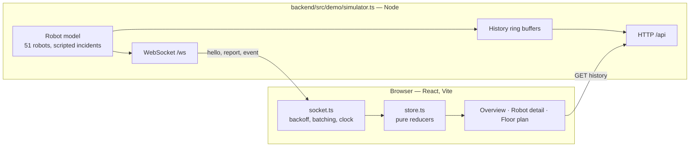

# Fleet Monitor — System Design

> Status: Draft v5 · Author: Pritom Mazumder · Date: 2026-11-09
> Scope: Olivaw Engineering Challenge — user interface, robot simulator, server side.

This document has two parts:

- **Part A** describes the demo: the interface plus an in-process mock backend (`npm run dev`).
- **Part B** describes the production design: MQTT, an ingest server and PostgreSQL. It keeps every rule from Part A and replaces the mock with real infrastructure. Part B is now built too (`docker compose up`). Where the build differs from or adds to the first draft, the section says so.

[Section 3](#3-demo-vs-production) maps the two parts. Where they differ, the reason is given.

### Repository layout

```
shared/     @fleet/shared — the code both sides must agree on
  src/protocol.ts     browser wire protocol (§6)
  src/status.ts       the status model and the freshness clock (§4)
  src/telemetry.ts    MQTT topics and zod payload schemas (§10–11)
  src/sites.ts        floor plans, used for drawing and for robot movement
frontend/   React + Vite client (§7)
backend/
  src/demo/simulator.ts   Part A mock backend
  src/sim/fleet.ts        robot model and scripted incidents, used by both backends
  src/sim/mqtt-robots.ts  one MQTT client per robot (Part B)
  src/sim/seed.ts         migrations + robot registry
  src/server/             Part B ingest + API server (§9)
  src/ops/pki.ts          dev CA, broker/server/robot certificates, broker ACL from the registry (§16)
  src/load/loadtest.ts    load generator and report (§17)
  migrations/             SQL (§13)
e2e/        Playwright browser tests against the demo backend (§17); playwright.config.ts at the root
lint/       ESLint config with its own install, not a workspace (§7, how the standard is enforced)
.github/workflows/ci.yml   every check on every push and pull request
deploy/mosquitto.conf, deploy/mosquitto.secure.conf, Dockerfile,
docker-compose.yml (plain), docker-compose.secure.yml (TLS override)
```

npm workspaces link the three packages. `@fleet/shared` is consumed as TypeScript source by Vite (client) and tsx (server), so there is no build step for it.

---

## Table of contents

1. [Context](#1-context)
2. [Goals and non-goals](#2-goals-and-non-goals)
3. [Demo vs. production](#3-demo-vs-production)
4. [Status model](#4-status-model)

**Part A — Built system**

5. [Architecture (demo)](#5-architecture-demo)
6. [Wire protocol](#6-wire-protocol)
7. [Client data layer](#7-client-data-layer)
8. [Simulator](#8-simulator)

**Part B — Production design**

9. [Architecture (production)](#9-architecture-production)
10. [MQTT design](#10-mqtt-design)
11. [Telemetry contract](#11-telemetry-contract)
12. [Ingest pipeline](#12-ingest-pipeline)
13. [Storage](#13-storage)
14. [API](#14-api)
15. [Failure modes](#15-failure-modes)
16. [Observability and security](#16-observability-and-security)

**Both**

17. [Testing](#17-testing)
18. [Decisions](#18-decisions)
19. [What I disagree with](#19-what-i-disagree-with)
20. [Open questions](#20-open-questions)

---

## 1. Context

Robots work at several warehouse sites. Each robot reports its state about once per second: battery, position, task and error state. The user is a fleet manager. They want to answer one question in under 3 seconds: **"Which robots need my attention right now?"**

The interface is the main part of the submission. The server exists to make the interface truthful: fresh, correct "now" data, and an honest signal when data is not fresh.

---

## 2. Goals and non-goals

### Goals

- G1. Show the current status of every robot. A new report reaches the screen within 1 s.
- G2. Mark a robot `offline` when it has not reported for more than 10 s.
- G3. Never mark a robot `offline` because **our own** link (browser ↔ server, or server ↔ broker) is down.
- G4. Show one robot's recent history: battery for 15 min, position trail for 4 min, events for today.
- G5. Keep one status model, one source of truth, used by the server and the client.
- G6. Document each trade-off and the condition that would change it.

### Non-goals

- Exactly-once delivery of telemetry.
- Commands to robots (the topic is reserved, the flow is not built).
- User accounts, roles and multi-tenancy.
- Mobile layout.

---

## 3. Demo vs. production

| Concern | Demo (built) | Production (designed) | Why the demo is enough |
|---|---|---|---|
| Robots → server | In-process simulator | MQTT via a Mosquitto broker | The client cannot tell the difference. The wire protocol to the browser stays the same. |
| Server → browser | WebSocket `/ws` | WebSocket `/ws` (same protocol) | No change. |
| Current state | Memory of the simulator process | Memory of the ingest server, written through to Postgres | One process, no restarts to survive. |
| History | Ring buffers in memory (15 min battery, 4 min trail, 80 events per robot) | Postgres, partitioned by day | The detail page only needs recent history. |
| Status rules | `shared/src/status.ts`, used by the client and the demo model | The same module, used by the ingest server | — |
| Run | `npm run dev` | `docker compose up --build` (or `npm run infra` + `npm run dev:prod` from source) | One command in both cases. |
| Fleet size | 51 robots, 4 sites (one empty) | Target 1,000 robots | — |

The browser does not know that the backend is a mock. Swapping the simulator for the production server changes no client code.

---

## 4. Status model

One model, used everywhere: the table, the cards, the map, the detail page, the headline and the event log.

```ts
type Status = 'ok' | 'low' | 'error' | 'offline' | 'never';
```

| Status | Rule (first match wins) | Meaning for the manager |
|---|---|---|
| `never` | Registered, no report yet | Unknown, but expected. Not counted as "needs attention". |
| `offline` | Last report more than 10 s ago | **We do not know.** Not "it broke". |
| `error` | Robot reports `state = 'error'` | Something broke. |
| `low` | Battery below 20 % | Needs to charge soon. |
| `ok` | All other cases | Quiet. |

Severity for sorting: `offline → error → low → never → ok`, then by ID.

### Rules that keep the model honest

- **Freshness uses one clock.** `statusClock()` returns the current server time while the link is live. When the link is lost, it returns the time of the last message received. So, a robot can turn `offline` only on evidence about the robot, never on evidence about our own link.
- **"Last seen" keeps counting** while the link is down. The manager sees staleness grow, but robot statuses do not change.
- **Offline wins over error and low.** An offline robot's last battery value is still shown, labelled *last known*.
- **The sort key uses only status and ID.** A battery or position update never moves a row.

### Production change: battery hysteresis

With 1 Hz reports, a battery near 20 % can flap between `low` and `ok`. So, a robot **enters** `low` below 20 % and **leaves** it at 22 % or more. The entry threshold stays 20 %, so the dashed line on the chart stays true.

Because the rule lives in the shared module, the demo and the client apply it too: `nextLow(battery, wasLow)` keeps a per-robot latch, and `deriveStatus(report, at, low)` reads it. The event text is "Battery back above 22%".

Known edge: the browser starts its latch from the `hello` snapshot. A robot at 20–21 % that the server holds as `low` shows `ok` in a freshly opened tab until it crosses 22 % or drops under 20 %. Closing it means sending the latch in `Report`. It has not been worth a protocol change yet.

---

# Part A — Built system

## 5. Architecture (demo)



| Path | Purpose |
|---|---|
| `ws /ws` | `hello` on connect, then one `report` per robot per second, and `event` on each transition |
| `GET /api/robots/:id/history` | Battery (15 min, every 5 s), trail (4 min, every 2 s), the last 40 events |
| `GET /api/health` | Robot and client counts |
| `POST /control/outage?seconds=N` | Drops all sockets and refuses new ones for N seconds. Demo only. |

With `STATIC_DIR` set (`npm run start:demo`), the same process also serves the built client.

---

## 6. Wire protocol

Defined in `shared/src/protocol.ts`. All timestamps are **server** epoch milliseconds.

```ts
type ServerMessage =
  | { type: 'hello'; serverTime: number; robots: RobotInfo[]; reports: Report[]; ingest?: Ingest }
  | { type: 'report'; r: Report }
  | { type: 'event'; e: RobotEvent }
  | { type: 'ingest'; ingest: Ingest }            // the ingest state changed after hello (§14)
  | { type: 'heartbeat'; serverTime: number };    // every 2 s

interface Ingest { state: 'live' | 'paused'; frozenAt: number | null }

interface RobotInfo {           // registry, sent once per connection
  id: string; model: string; modelFull: string; siteKey: string;
  firmware: string; network: string; registeredAt: number;
  lastCharge: [start: number, end: number] | null;
}

interface Report {              // about 1 per robot per second
  id: string; t: number; battery: number; x: number; y: number;
  state: 'ok' | 'error';        // "offline" is never reported; it is derived
  fault?: string; task: string; since: number;
}

interface RobotEvent {
  id: string; t: number;
  kind: 'info' | 'low' | 'warn' | 'error' | 'off' | 'ok';
  text: string; sub?: string;
}
```

### Why a heartbeat

The client's stall watchdog treats 5 s of silence on an open socket as a dead link. Before Part B, reports always flowed, so silence meant a dead link. With ingest paused (or every robot offline), no reports flow while the link is healthy. A heartbeat every 2 s keeps the watchdog honest. It also advances `lastMessageAt`, so a later connection loss freezes the clock at the right time.

### Why `hello` is a full snapshot

On every connect and reconnect the server sends the whole registry and the last report of each robot. There is no replay of missed messages. The snapshot is small (one entry per robot), always correct, and removes a whole class of reconnect bugs. A robot without a report in `hello` is `never`.

---

## 7. Client data layer

All paths are under `frontend/src/`.

| File | Responsibility |
|---|---|
| `data/socket.ts` | Opens the socket. Reconnects with backoff 1, 2, 5, 10 s and shows the attempt count. A 5 s stall watchdog treats a silent open socket as dead. **Validates every frame** against the zod `ServerMessage` schema from `@fleet/shared/protocol`: a malformed frame is dropped and warned about once per type, and an unknown `type` (a newer server) is ignored. Applies reports in 250 ms batches, so the store changes about 4 times per second, not 50. Runs **the one clock**: a single `setInterval(1000)` aligned to the second. The watchdog runs *before* the clock advances, so after a laptop wakes, a dead socket is noticed before any robot can look silent. Handles `ingest` and `heartbeat`. |
| `data/store.ts` | Pure reducers (`applyHello`, `applyReports`, `applyTick`, `applyLost`, `applyIngest`, `applyHeartbeat`, `applyEvent`) and a small `useSyncExternalStore` store with selector equality. Each reducer re-derives status. A status change stamps `changedAt`, which drives the 1.8 s row highlight. |
| `data/types.ts` | `Robot` is a discriminated union: `{ status: 'never', report: null } \| { status: ReportedStatus, report: Report }`. Checking one narrows the other, so no code asserts `report!`. |
| `data/history.ts` | Fetches history on open, every 10 s and after a reconnect, and **validates it** with the `RobotHistory` schema. Extends the trail from live reports through a store subscription. Merges live events into history by `eventId`. |
| `lib/status.ts` | Re-exports `@fleet/shared/status`. Adds `statusClock()` (frozen while our link is lost **or** ingest is paused), `isStale()`, and colours. |
| `lib/sort.ts` | Sort by severity, then ID. |
| `components/Clock.tsx` | `<Ago>` and `useWithin()`: the leaves that read the clock themselves ([render cost](#render-cost)). |
| `components/ErrorScreen.tsx` | The crash screen, the router's `errorElement` and the top-level error boundary ([failure inside the client](#failure-inside-the-client)). |

### Clock offset

`hello` carries `serverTime`. The client stores `offset = serverTime − Date.now()` and keeps `now` in server time. So, a wrong laptop clock does not make robots look offline.

### Hover sync

One `hover` value in the store. Table rows, cards, map pins and floor-plan list items read and write it.

### Logic reads codes, never display text

The protocol carries each meaning twice: a code for logic and a text for people. The client branches only on the code.

| Field | Used for | Never used for |
|---|---|---|
| `Report.taskKind` (`picking`, `returning_to_dock`, `waiting_for_dock`, `charging`, `idle`, `other`) | The low-battery plan on the detail page ("It is on its way to charge"), the charging icon, "Charging in the dock" | `Report.task` is shown as is and may change wording at any time |
| `RobotEvent.code` and `bay` | Which bay a returning robot is heading to (`bay_assigned`) | `text` and `sub` are shown as is |
| `RobotEvent.eventId` | Merging live events with history, and React keys | `t + text` is not unique and changes with wording |

An unknown code from a newer server reads as `other` (`.catch('other')` in the schema), so an old client degrades to plain text instead of dropping the message.

### Render cost

Target: 1,000 robots in one view (Part B).

- **Robot data reaches the store at most about 4 times a second** (the report batches), and the clock once a second.
- **A tick does not re-render rows or markers** (a render-count test proves it for rows). Rows and map markers are `memo` components and do not take `now` as a prop. The text that depends on time ("3 s ago", the row highlight) lives in leaves (`<Ago>`, `useWithin`) that subscribe to the clock and re-render only when their own output changes.
- **A report batch re-renders only the rows whose robot changed.** Reducers keep the object identity of every robot that did not change, and `RobotTable` hands each row a stable ref callback, so `memo` holds.
- **Known cost:** `Overview` itself subscribes to `now` for the attention cards (at most 8), so the page component re-renders once a second. Its derived lists are memoized on the robot map and do not recompute on a tick.
- **Not measured yet:** there is no browser profile at 1,000 robots, and the table is not virtualized. *Change when:* a React Profiler commit on the overview passes 16 ms at the target fleet size → virtualize the table, and move the attention cards onto `<Ago>`.

### Failure inside the client

A control-room screen must never go blank: an empty page looks like an empty fleet.

- **A page that throws while rendering** is caught by the root route's `errorElement`. It shows "This view stopped working" with Reload, a link to the overview and the error message, and logs to the console.
- **Anything above the routes** is caught by `AppErrorBoundary`, which shows the same screen.
- The socket and the clock run outside React, so they survive both. The crash screen uses no router hooks and no top bar, because either could be what failed.
- **Not built:** a boundary per panel (a map that throws takes the table down with it), and automatic recovery. A reload loop on a wall display is worse than a visible error.

### How the standard is enforced

| Check | Command | Catches |
|---|---|---|
| Types | `npm run typecheck` (TypeScript 7, `strict`) | Vitest does not type-check, so this is the only gate for types. It caught the half-finished `taskKind` / `eventId` change. |
| Lint | `npm run lint` (ESLint 10, `--max-warnings 0`) | `react-hooks` with the React Compiler rules (rules of hooks, exhaustive deps as an error, set-state-in-effect, purity, refs), `typescript-eslint` recommended, no non-null assertions in app code, `eqeqeq` |
| Unit and component tests | `npm test` | See [section 17](#17-testing) |
| Coverage | `npm run test:coverage` | Fails below 95 % lines, statements, functions and branches |
| Browser flows | `npm run test:e2e` | See [section 17](#17-testing) |

CI (`.github/workflows/ci.yml`) runs all of them on every push and pull request.

ESLint has its own package in `lint/`, with its own lockfile (`npm run lint:install`). typescript-eslint parses with the TypeScript 6 compiler API, and TypeScript 7 has no such API. As a workspace, npm would hoist part of the lint toolchain next to TypeScript 7, and it would break. Lint therefore uses no rule that needs type information; `tsc` covers types.

---

## 8. Simulator

The robot model lives in `backend/src/sim/fleet.ts`. Two runners use it:

- `backend/src/demo/simulator.ts` (Part A) runs it in process and sends reports straight to browsers.
- `backend/src/sim/mqtt-robots.ts` (Part B) opens one MQTT client per robot. Each client has an LWT, a boot counter and a seq number, and a configurable clock skew (`CLOCK_SKEW_MS`). `ROBOTS=1000` adds load-test robots.

Each model event has an origin. `robot` events (task, charging, fault, Wi-Fi) are published by the MQTT robots. `server` events (low, ok, off) are status transitions: only the demo emits them from the model, and in Part B the ingest server derives them.

Model behaviour:

- 50 robots across Hamburg DC, Leipzig Hub and Munich North, plus `R-051`, registered but never reported. Berlin South has no robots, so the empty state is real data.
- On start, it simulates the previous 15 minutes, so charts and trails have data at once.
- Robots work along aisles, drain battery, return to dock below a threshold, and charge.
- Each robot reports at its own offset inside the second, like real radios.
- Randomness is seeded, so every run is the same.

### Scripted incidents

In the demo, incidents happened before start, so the dashboard opens with them. In MQTT mode (`incidents: 'live'`), they happen shortly after start, so a fresh server and database watch them happen: R-024 faults at +8 s, R-041 warns at +20 s and drops its link at +45 s (the broker publishes its LWT), and R-009 goes silent at +35 s while staying connected.

| Robot | Incident | Shows |
|---|---|---|
| R-009 | Stopped reporting 34 s before start | Offline, short |
| R-041 | Stopped reporting 3 min before start, after a weak Wi-Fi warning | Offline, long; the event log explains why |
| R-017 | 14 %, returning to dock | Low battery, detail page |
| R-032 | 9 %, all charging bays busy; a dock frees up after 10 min | Low battery, then recovery |
| R-024 | "Motor overcurrent" | Error |
| R-028 | Drops below 20 % about 7 s after start | Status-change highlight |
| R-051 | Registered, never reported | `never` state |
| all | `npm run outage` drops every socket for 20 s | Connection-lost banner, frozen statuses |

---

